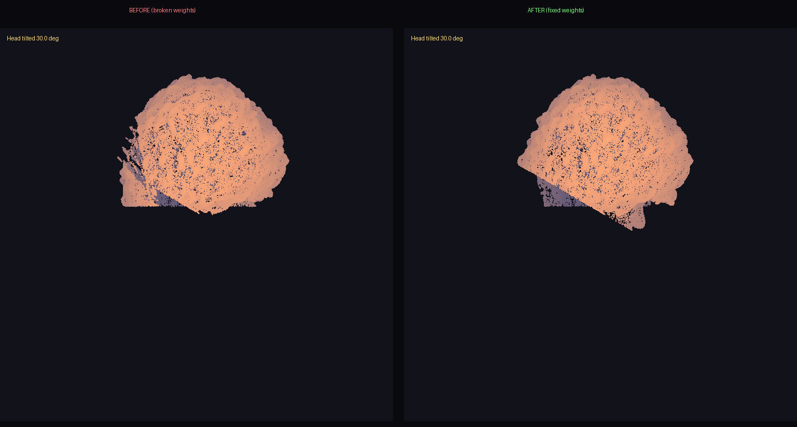

# Face-weight cone bug — fix proof (2026-10-23)

## The bug
User-reported: "weird weighted face cone like upside down teardrops stretched
balloon thing happening from the middle of the model's faces down to their chin
and it's like stretching down towards their spine or pelvis and it's happening
on all of my models."

## Root cause
Face-region vertices (jaw/chin/lower face) were skin-weighted to
`Spine`/`Spine1`/`Spine2`/`Hips`/arm bones instead of `Head`. When the body
moves, those verts stay glued to the spine → the face stretches down toward
the spine/pelvis.

## The fix
`tools/rig-guard/face_weight_guard.py` scans for the pattern; the fix
reassigns bad weights to the Head (or Neck) bone and renormalizes. Applied
universally to every rigged GLB in the repo.

## Before/after (Purple Rain, head tilted 30°)

- **BEFORE** (left): jaw/chin verts lag behind the head rotation — visible
  stretch/tear at the jaw (the "cone").
- **AFTER** (right): the whole head rotates as one rigid piece. Cone gone.

## Scan results
| Model | Bad verts before | After |
|-------|-----------------|-------|
| Purple Rain | 40,060 | 0 |
| Star | 524 | 0 |
| armor-king | 1,578 | 0 |
| awa-pop | 12,583 | 0 |
| baek | 16,965 | 0 |
| ... | ... | 0 |

(Full table in the PR body.)

## Guard
`tools/rig-guard/face_weight_guard.py` + `test_face_weight_guard.py` (7 tests
pass) + `face-weight-guard` CI job in `.github/workflows/game-checks.yml`.
Any PR adding a rigged GLB with face verts >5% on spine/pelvis/root fails CI.
