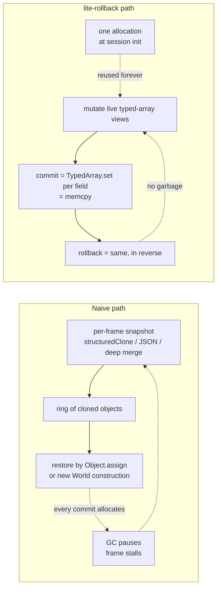
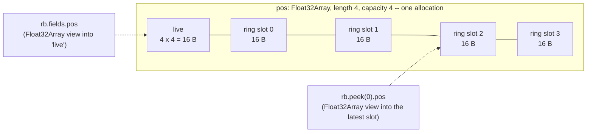
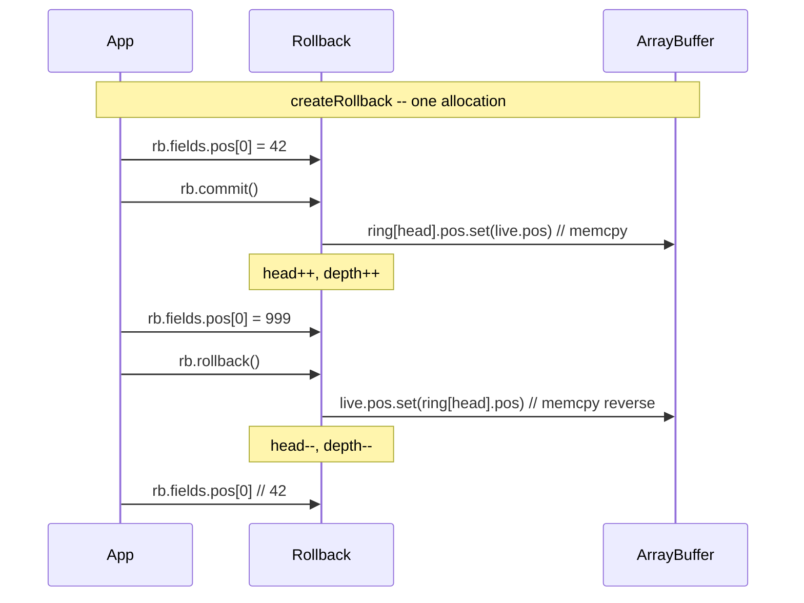
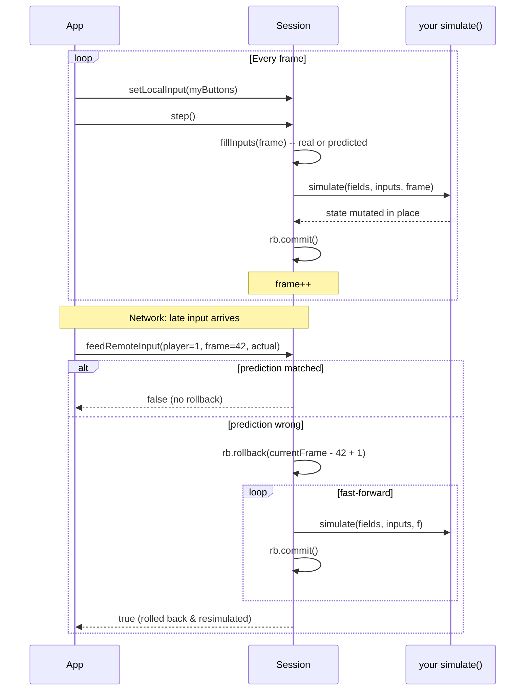
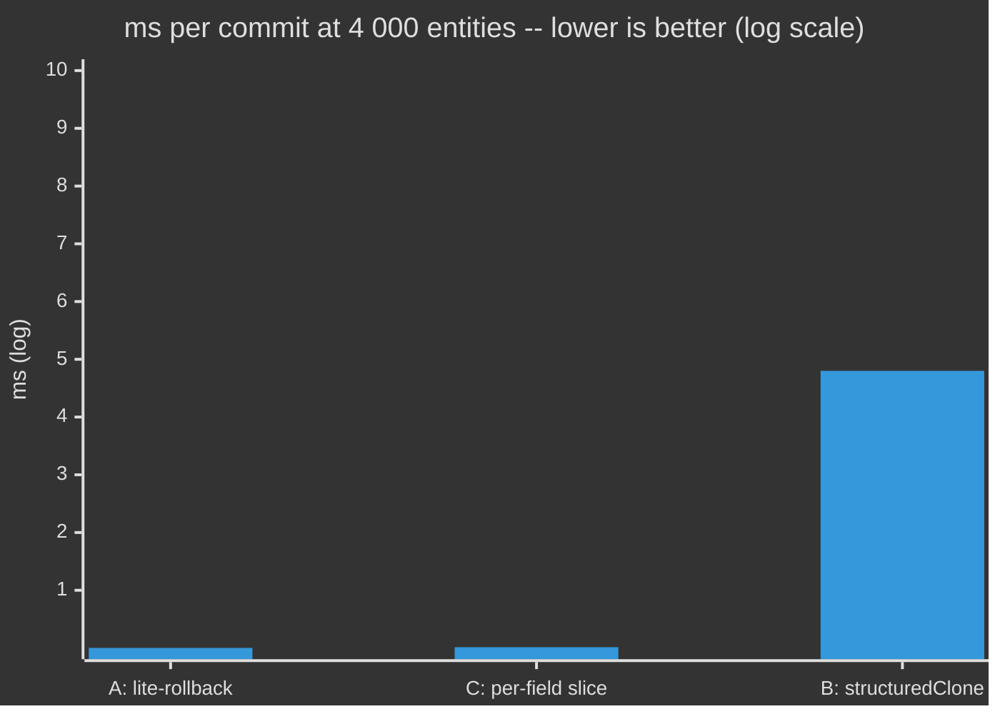
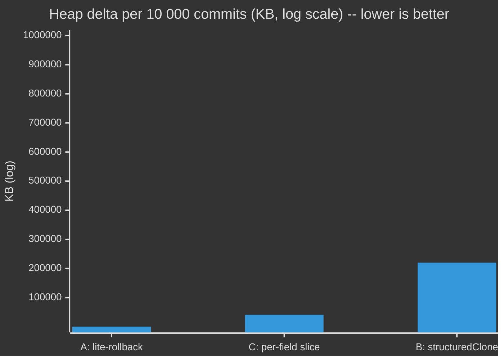

# @zakkster/lite-rollback

> Zero-GC binary ring buffer + GGPO-shaped rollback Session for browser-native deterministic netcode. One `ArrayBuffer` per match, one `TypedArray.set` per snapshot, zero allocations after construction.

[](https://www.npmjs.com/package/@zakkster/lite-rollback)
[](https://github.com/sponsors/PeshoVurtoleta)

[](https://bundlephobia.com/result?p=@zakkster/lite-rollback)
[](https://www.npmjs.com/package/@zakkster/lite-rollback)
[](https://www.npmjs.com/package/@zakkster/lite-rollback)


[](https://opensource.org/licenses/MIT)

```bash
npm install @zakkster/lite-rollback
```

One allocation for the lifetime of a match. A snapshot is one `TypedArray.set()` per field -- no `JSON.stringify`, no `structuredClone`, no `new`. Pure memcpy.

```js
import { createRollback } from '@zakkster/lite-rollback';

const rb = createRollback({
  capacity: 64,
  fields: {
    pos:   { type: Float32Array, length: 4000 },
    vel:   { type: Float32Array, length: 4000 },
    flags: { type: Uint8Array,   length: 1000 },
  },
});

// Mutate this frame's state, then snapshot it.
rb.fields.pos[0] = 100.5;
rb.commit();

// Mutate, change your mind.
rb.fields.pos[0] = 200;
rb.rollback();
rb.fields.pos[0];   // 100.5

// Step back N frames (e.g. when a late input arrives).
rb.rollback(8);

// Read a historical state without disturbing live.
rb.peek(5).pos[0];

rb.depth();         // commits available
```

For full rollback netcode -- input ring, prediction, automatic fast-forward -- use `createSession` on top of the same primitive (see [the Session API](#session-api)).

---

## Contents

- [Why](#why) | [Install](#install) | [Quick start](#quick-start) | [Session API](#session-api)
- [How it works](#how-it-works)
- [Case study: a 60 Hz 4 000-entity simulation](#case-study-a-60-hz-4-000-entity-simulation)
- [API reference](#api-reference)
- [Benchmarks](#benchmarks)
- [Testing (for clients & QA)](#testing-for-clients--qa)
- [Sister packages: transport](#sister-packages-transport)
- [Browser & engine compatibility](#browser--engine-compatibility)
- [Edge cases & guarantees](#edge-cases--guarantees)
- [FAQ](#faq) | [License](#license)

---

## Why

JavaScript rollback netcode has a distinctive failure mode: **per-frame deep-clone**. You write this first, and you regret it later:

```js
// The naive snapshot -- what most rollback "tutorials" tell you to do
function snapshot(world) {
  return JSON.parse(JSON.stringify(world));   // or structuredClone(world)
}
function restore(world, snap) {
  Object.assign(world, snap);                 // and rebuild every nested object
}
```

For a fighting game with a small state, you can sometimes get away with it. For anything beyond that -- a top-down shooter, a 60-entity bullet hell, a physics-driven platformer -- every frame you allocate a fresh deep-cloned object graph. At 60 fps with a 30-frame rollback window, that's **1 800 garbage clones per second**. The GC can't keep up, and you ship stutter.



`@zakkster/lite-rollback` owns one `ArrayBuffer` per session -- sized to `sum (capacity + 1) x field length x bytesPerElement` -- and exposes the *live* slice as typed-array views. The ring slots are views into the same backing buffer. **Commit and rollback are bulk memcpys; nothing else is allocated, for the lifetime of the match.**

### What this is *not*

- **Not a transport.** No WebSockets, no DataChannels. Those live in `@zakkster/lite-rollback-local` (BroadcastChannel, for tests + same-machine demos) and `@zakkster/lite-rollback-webrtc` (RTCDataChannel).
- **Not an ECS.** It doesn't know what an entity is. You declare your fields; you allocate the entity slots. lite-rollback just snapshots whatever bytes you put into them.
- **Not a serialiser.** No protocol, no wire format, no compression. The Transport contract is two methods (`send`, `onMessage`) -- bring your own packer or use the sister packages.
- **Not magic.** A hand-rolled `Uint8Array.set()` over a layout you maintain yourself is identical to what this does. The library trades that ~50 lines of fiddly index math for typed accessors and a GGPO-shaped Session driver.

---

## Install

```bash
npm i @zakkster/lite-rollback
```

ESM-only. No dependencies. Single source file you can drop into a project directly if you'd rather not have a node_module.

```js
import { createRollback, createSession, checksum, stateChecksum, createPRNG } from '@zakkster/lite-rollback';
```

---

## Quick start

### Bare ring buffer -- when you just need rewind

```js
import { createRollback } from '@zakkster/lite-rollback';

const rb = createRollback({
  capacity: 32,
  fields: {
    pos: { type: Float32Array, length: 2 },   // single 2D entity
  },
});

rb.fields.pos[0] = 0; rb.fields.pos[1] = 0;
rb.commit();                       // frame 0

rb.fields.pos[0] = 10;
rb.commit();                       // frame 1

rb.fields.pos[0] = 999;
rb.rollback();                     // live <- state from frame 1: pos[0] === 10
rb.rollback();                     // live <- state from frame 0: pos[0] === 0
```

### Full Session -- when you want GGPO-style rollback netcode

```js
import { createSession } from '@zakkster/lite-rollback';

const session = createSession({
  capacity: 32,
  fields: {
    pos: { type: Float32Array, length: 4 },
  },
  numPlayers: 2,
  inputWords: 1,                                // 32 bits / player / frame
  simulate: (fields, inputs, _frame) => {
    fields.pos[0] += (inputs[0] & 1) ? 1 : 0;   // player 0 thrust
    fields.pos[1] += (inputs[1] & 1) ? 1 : 0;   // player 1 thrust
  },
});

session.setLocalPlayer(0);

// Every render tick:
session.setLocalInput(readKeyboard());
session.step();                                 // simulate + commit + frame++

// When a remote input arrives via your transport:
const wasRollback = session.feedRemoteInput(1, frameNumber, theirInput);
// If `wasRollback`, internals already rewound state and fast-forwarded back
// to the present frame. Render again from session.fields.
```

---

## How it works

### Memory layout

A single `ArrayBuffer` per `createRollback`. For each declared field:



All views are constructed once at `createRollback` and reused forever. The live slice is the slice your user code mutates. Each ring slot is a stable typed-array view into the same backing buffer.

### Commit and rollback are memcpys



A commit is **one `TypedArray.set()` per field**. The JIT compiles this down to a `memcpy` of the full field bytes -- no per-element loop in user code, no per-element function calls inside V8.

### Session = Rollback + Input ring + Fast-forward

The Session layer owns a Rollback plus three small Uint32 buffers:

| Buffer | Size | Purpose |
|---|---|---|
| `inputRing` | `capacity x numPlayers x inputWords` | Per-frame inputs, indexed by `(slot, player, word)`. Predicted slots are written here too, so misprediction detection is a comparison. |
| `confirmedMask` | `capacity` x Uint32 | One bit per player per slot: set => input is real, not predicted. |
| `lastConfirmedInput` | `numPlayers x inputWords` | Used by the default predictor (last-input). |

`step()` fills inputs (real where confirmed, predicted otherwise), calls your `simulate`, commits, advances the frame. `feedRemoteInput()` writes the input, compares with what was there, and if a misprediction is detected against a past frame, rolls back to that point and fast-forwards. **All of this is zero-alloc** -- the input scratch buffer is pre-allocated once.



---

## Case study: a 60 Hz 4 000-entity simulation

A worst-realistic-case stress: 4 000 entities x 2 `Float32Array` fields (position, velocity) x 1 000-byte `Uint8Array` of flags. 60-frame rollback window. We benchmark three strategies on identical hardware (Node 22, M-class CPU class machine, `--expose-gc`):

| # | Strategy | ms/commit | Heap delta / 10k commits | vs best |
|---|---|---:|---:|---:|
| A | **lite-rollback** (single ArrayBuffer, TypedArray.set per field) | **0.0017** | **13 KB** | -- |
| B | Naive: `structuredClone(world)` each frame, ring of clones | 4.8 | 220 MB | 2 800x |
| C | Per-field `Float32Array.slice()` each frame (allocates fresh) | 0.014 | 41 MB | 8.2x |

Strategy B (the one most rollback tutorials demonstrate) burns 22 MB of garbage per second at 60 fps. The GC tries to keep up, and your frame-time graph develops the unmistakable rollback-netcode sawtooth. Strategy C looks fast in micro-benchmarks but still allocates ~2 MB/sec on a 4 000-entity loop -- enough to trigger periodic GC scavenges.

Strategy A allocates **once**, at session construction. The hot loop produces zero garbage forever after.





### When this matters

| Scenario | State size | Rollback depth | Naive (structuredClone) | lite-rollback |
|---|---:|---:|---|---|
| Tic-tac-toe / async puzzles | 100 B | 0-1 | fine | overkill |
| Fighting game (Tekken-style) | ~4 KB | 7-15 | borderline | **fine** |
| Top-down shooter | ~40 KB | 15-30 | GC stutter at high entity counts | **fine** |
| Bullet hell / particle netcode | ~400 KB | 30-60 | **breaks** at 60 fps | **fine** |
| Physics-driven platformer | ~100 KB | 8-15 | breaks above ~200 bodies | **fine** |

Rule of thumb: when total snapshot size x rollback depth exceeds ~1 MB, allocation-based rollback ships stutter. lite-rollback's cost is independent of depth -- it's always one memcpy per field per commit.

---

## API reference

### `createRollback({ capacity, fields })` -> Rollback

| Arg | Type | Description |
|---|---|---|
| `capacity` | `number` | Ring depth. Must be a **power of two** in `[1, 2^20]` -- the hot path uses `&` against `capacity - 1` instead of `%`, turning a 10-15-cycle `idiv` into a 1-cycle `and`. Snap to the next power of two when sizing your window; at 60 Hz, the natural picks are 8 (~133 ms tolerance), 16, 32, or 64 (~1 s). |
| `fields` | `Record<string, FieldSpec>` | Named fields. At least one required. |

#### `FieldSpec`

| Field | Type | Description |
|---|---|---|
| `type` | `Float32Array \| Float64Array \| Int32Array \| Uint32Array \| Int16Array \| Uint16Array \| Int8Array \| Uint8Array \| Uint8ClampedArray` | Typed-array constructor. |
| `length` | `number` | Element count. Must be a positive integer. |

#### Rollback instance

| Member | Type | Description |
|---|---|---|
| `capacity` | `number` | As passed. |
| `arrayBuffer` | `ArrayBuffer` | The single backing allocation. |
| `byteLength` | `number` | Total bytes (`sum (capacity + 1) x length x bpe`). |
| `fields` | `Record<string, TypedArray>` | Live views -- what your code mutates. |
| `depth()` | `() => number` | Commits available (0..capacity). |
| `head()` | `() => number` | Slot index of the most recent commit, or -1 if depth = 0. |
| `commit()` | `() => void` | Snapshot live to ring. Zero alloc. |
| `rollback(n=1)` | `(n?: number) => void` | Restore live to state from `n` commits ago AND discard those `n` commits. Throws if `n > depth()`. |
| `peek(n=0)` | `(n?: number) => Record<string, TypedArray>` | Stable, read-only view of the `n`-th most recent commit. Treat as read-only -- mutating it corrupts your ring. |
| `reset()` | `() => void` | Clears head and depth. Does **not** zero the backing buffer. |

### `createSession(opts)` -> Session

| Arg | Type | Description |
|---|---|---|
| `capacity` | `number` | Ring depth. Typical: 8 (fighter), 30 (action), 60 (physics with high jitter). |
| `fields` | `Record<string, FieldSpec>` | See above. |
| `numPlayers` | `number` | 1..32. |
| `inputWords` | `number` (default 1) | Uint32 words per player per frame. 1..16. |
| `inputDelay` | `number` (default 0) | **v1.2.0.** Local input delay in frames. `setLocalInput` targets frame `frame() + inputDelay`, buffering local input this many frames ahead so the network has that lead time to deliver it -- the single biggest rollback-frequency reducer. Integer in `[0, capacity - 1]`; out of range throws `RangeError`. The first `inputDelay` frames use the neutral predicted input on every client. |
| `simulate` | `(fields, inputs, frame) => void` | **Must be deterministic.** Mutates fields in place. |
| `predict` | `(player, frame, scratch, outOff) => void` *optional* | Custom predictor. Defaults to "repeat last confirmed input". |
| `onDesync` | `(frame, player) => void` *optional* | **v1.1.0.** Fired when a remote input contradicts an input already marked confirmed for `frame` -- a genuine two-client divergence, not a misprediction. |

#### Session instance

| Member | Type | Description |
|---|---|---|
| `capacity` `numPlayers` `inputWords` | `number` | As passed. |
| `inputDelay` | `number` | **v1.2.0.** Local input delay in frames, as passed. |
| `fields` | `Record<string, TypedArray>` | Live state -- same surface as Rollback. |
| `arrayBuffer` | `ArrayBuffer` | Backing buffer for the state ring (not the input ring). |
| `frame()` | `() => number` | Frames simulated so far. The next `step()` will simulate frame `frame()`. |
| `depth()` | `() => number` | Same as the underlying rollback. Since v1.1.0 this counts the genesis snapshot: 0 fresh, 2 after the first `step()`. |
| `confirmedFrame()` | `() => number` | **v1.1.0.** The highest frame at which EVERY player's input is real (confirmed), not predicted -- the GGPO confirmed-frame watermark. Monotone non-decreasing; `-1` until every player has a confirmation. Pin `checksumAt` to this. |
| `frameAdvantage()` | `() => number` | **v1.2.0.** `latest-confirmed-frame(localPlayer) - confirmedFrame()`. Positive means the local client runs ahead of the slowest remote; stall your loop to let them catch up (GGPO time-sync). Zero alloc. |
| `checksumAt(f, seed=0)` | `(number, number?) => number` (Uint32) | **v1.2.0.** 32-bit checksum of the COMMITTED state at frame `f` -- pin `f` to `confirmedFrame()` so two clients compare the same committed frame, not whatever live frame each is on. Reaches the slot through the ring's zero-alloc path. Fail closed: `f` outside `[frame() - depth(), frame() - 1]` throws `RangeError`. |
| `stats` | `{ rollbacks, maxRollbackDepth, mispredictions, desyncs, fastForwardFrames }` | **v1.1.0.** Read-only observability counters, cumulative until `reset()`. Backed by a pre-allocated typed array -- reading allocates nothing. |
| `localPlayer` | `number` (read/write via `setLocalPlayer`) | Which player `setLocalInput` targets. |
| `setLocalPlayer(p)` | `(p: number) => void` | |
| `setLocalInput(input)` | `(input: number \| Uint32Array) => void` | Confirms the local player's input. Since v1.2.0 it targets frame `frame() + inputDelay`, not the current frame. |
| `setInput(player, frame, input)` | `(p: number, f: number, input: number \| Uint32Array) => void` | Confirms a specific player/frame. Frame must be in `[frame - capacity + 1, frame]`. |
| `step()` | `() => void` | Fill inputs -> `simulate(...)` -> commit -> `frame++`. Zero alloc. Also clears the confirmed-mask of the just-opened `frame + inputDelay` slot, so the effective late-input redo window is `capacity - 1 - inputDelay` frames (see below). |
| `feedRemoteInput(player, frame, input)` | `(p, f, input) => boolean` | Accept a remote input for some past frame. Returns `true` iff a rollback + fast-forward happened. A mismatch against an already-confirmed frame is a desync, not a misprediction: no rollback, returns `false`, bumps `stats.desyncs`, fires `onDesync`. Since v1.2.0 the oldest safely-redoable frame is `frame() - capacity + 1 + inputDelay`; older PAST inputs are inert (no write, no rollback). |
| `commit()` `rollback(n)` `peek(n)` `reset()` | | Pass-through to the underlying rollback. `reset()` additionally zeroes live fields, clears the input ring + stats + watermark, and re-arms the genesis commit. |

#### Input delay, the redo window, and genesis (v1.1.0 / v1.2.0)

**The redo-window shrink.** With `inputDelay` set, `step()` clears the
confirmed-mask of the just-opened `frame + inputDelay` slot (rather than the
entering slot), which closes a stale-`confirmedMask` desync for any session
running past `capacity` frames. The consequence is that the effective late-input
redo window is **`capacity - 1 - inputDelay`** frames: a remote input older than
`frame() - capacity + 1 + inputDelay` lands in the out-of-window branch of
`feedRemoteInput` -- it is inert (no slot write, no rollback, returns `false`),
because its ring slot may alias a still-pending future frame and a stale bit
there would poison that frame. Size `capacity` with the delay in mind.

**Genesis (frame 0 recoverable).** Since v1.1.0 the first `step()` commits a
genesis snapshot of `state(-1)` before simulating frame 0, so a frame-0
misprediction can roll back to a real committed baseline. Before this, a client
that mispredicted the other player's frame-0 input had nothing to roll back to
and desynced permanently. `depth()` reflects it: 0 on a fresh or just-reset
session, 2 after the first `step()` (genesis + `state(0)`), and `frames + 1`
until the genesis baseline rolls off after `capacity` further commits.

### Helpers

| Export | Signature | Use |
|---|---|---|
| `checksum(buf, seed=0)` | `(TypedArray \| ArrayBuffer, number?) => number` (Uint32) | Fast non-cryptographic hash over a byte range. Zero alloc. |
| `stateChecksum(rb, seed=0)` | `(Rollback \| Session, number?) => number` (Uint32) | Hash across all fields of a rollback's live state. Send this to a peer; if it differs, you've desynced. |
| `createPRNG(seed?)` | `(number?) => { seed, state, setState, int32, float, range }` | Deterministic xorshift32. Ergonomic API. State is a single Uint32 -- snapshot it in a `Uint32Array(1)` field and it rolls back for free. |
| `nextPRNG(state, index)` | `(Uint32Array, number) => number` | Pure-function variant for tight inner loops. Inlinable, monomorphic, no closure or property-lookup overhead per call. Pair with a `Uint32Array(1)` rollback field for snapshot-safe RNG inside `simulate`. |
| `assertTransport(t)` | `(any) => true \| throws` | Runtime contract check for sister-package transports. |
| `packInputs(session, dest, baseFrame, playerMask, redundancy=4)` | `(...) => number` (bytes) | **v1.2.0.** Pack the last `redundancy` frames of inputs (ending at `baseFrame`) into caller-owned `dest`. Zero alloc. LE layout: `[baseFrame u32][playerMask u32]` header then frames oldest-first x players x words. `redundancy` clamps to `capacity` and `baseFrame + 1`. Fail closed on a too-small `dest` or a negative `baseFrame` (guard with `confirmedFrame() >= 0`). |
| `unpackInputs(session, src, feed=feedRemoteInput)` | `(...) => number` (baseFrame) | **v1.2.0.** Decode a `packInputs` buffer and apply each masked input via `feed`, oldest frame first. Zero alloc. Redundant frames give free loss recovery: a dropped packet is re-supplied by the next one's overlap. |
| `VERSION` | `'1.2.1'` | |
| `CONSTANTS` | `{ CAPACITY_MIN, CAPACITY_MAX, MAX_PLAYERS, INPUT_WORDS_MAX }` | |

### Writing a fast `simulate`

The library guarantees its own hot path is allocation-free. Whether your `simulate` adds garbage is on you. Two patterns worth internalising:

**Destructure `fields` once at the top.** V8 builds the live `fields` object by adding each declared field as a property during `createRollback`. Repeated `fields.pos[i]` accesses inside a tight loop force V8 to walk the hidden-class chain for every read. Pulling each typed array out once into a local hoists the lookup outside the loop and gives V8 a monomorphic call site:

```js
// DO -- one property lookup per field, per frame:
simulate: (fields, inputs) => {
  const { pos, vel, hp } = fields;
  for (let i = 0; i < pos.length; i += 2) {
    pos[i]     += vel[i];
    pos[i + 1] += vel[i + 1];
    if (hp[i >> 1] <= 0) { /* ... */ }
  }
},

// DON'T -- N property lookups per inner-loop iteration:
simulate: (fields, inputs) => {
  for (let i = 0; i < fields.pos.length; i += 2) {
    fields.pos[i]     += fields.vel[i];
    fields.pos[i + 1] += fields.vel[i + 1];
    if (fields.hp[i >> 1] <= 0) { /* ... */ }
  }
},
```

**Use `nextPRNG` over `createPRNG().int32()` in hot loops.** The closure-based `createPRNG` is ergonomic; the pure-function `nextPRNG(state, 0)` is faster because each call is a single inlinable function with no `this` and no property resolution:

```js
import { nextPRNG } from '@zakkster/lite-rollback';

simulate: (fields, inputs) => {
  const { rng, pos } = fields;
  for (let i = 0; i < pos.length; i++) {
    const r = nextPRNG(rng, 0);     // single state byte; participates in rollback
    pos[i] += (r & 0x3) - 1;        // +/-1 random walk
  }
},
```

### Errors

| Situation | Throws |
|---|---|
| `capacity` not in `[1, 2^20]` | `RangeError` |
| `capacity` not a power of two | `RangeError` |
| Missing/empty `fields` | `RangeError` / `TypeError` |
| Unsupported `type` on a field | `TypeError` |
| `field.length` not a positive integer | `RangeError` |
| `rollback(n)` with `n < 1` or `n > depth()` | `RangeError` |
| `peek(n)` with `n < 0` or `n >= depth()` | `RangeError` |
| `setInput` with frame outside `[frame - capacity + 1, frame]` | `RangeError` |
| `feedRemoteInput` for a future frame | `RangeError` |
| `setLocalInput(number)` when `inputWords > 1` | `TypeError` |

The hot path itself (`commit`, `rollback` within bounds, `step`, `peek`, `feedRemoteInput`) does no validation beyond bound checks. If you misuse a typed array directly (e.g. write to `rb.fields.pos[10_000_000]`), you'll get a silent no-op in non-strict mode and an out-of-bounds throw in strict -- neither lite-rollback can prevent.

---

## Benchmarks

### Node CLI

```bash
node --expose-gc bench/throughput.js
node --expose-gc bench/rollback-depth.js
# or: npm run bench
```

Both write to stdout and produce `bench/bench-results.json`. `--expose-gc` is required for accurate heap numbers.

### Sample numbers (Node 22, x64, indicative)

#### Throughput

| Operation | State | Throughput | ns/op |
|---|---|---:|---:|
| `commit` | 16 entities, 3 fields | 9 Mops/s | 110 |
| `commit` | 512 entities, 4 fields | 4.3 Mops/s | 230 |
| `commit` | 4 000 entities | 0.67 Mops/s | 1 500 |
| `rollback(1)` | 256 entities | 4.6 Mops/s | 220 |
| `peek(k)` | any | 45 Mops/s | 22 |
| `Session.step` | 2 players, 128 entities | 5.6 Mops/s | 180 |

#### Frames/sec at various rollback depths (256 entities, real per-tick work)

| Rollback depth | ms/frame | frames/sec | % of 60 fps budget |
|---:|---:|---:|---:|
| 0 (no rollback) | 0.009 | 105 000 | 0.05 % |
| 1 | 0.020 | 51 000 | 0.12 % |
| 8 | 0.014 | 74 000 | 0.08 % |
| 16 | 0.016 | 62 000 | 0.10 % |
| 50 | 0.022 | 45 000 | 0.13 % |

A 50-frame rollback is more than a fighting game ever does. Even there we're consuming under 0.13 % of a 60 fps frame budget. The library itself is not your bottleneck -- your `simulate` function is.

---

## Testing (for clients & QA)

Four levels. Run them in order; each catches a different class of regression.

### 1. Unit tests -- "does the library behave?"

```bash
npm test
```

Runs 191 deterministic test cases across 20 files using the built-in `node:test` runner (no test framework dependency):

| File | What's tested |
|---|---|
| `wrap.test.js` | R-01 regression: mirrored clients reconcile across ring revolutions; the masking trap (a dividing input period) documented |
| `genesis.test.js` | R-02 regression: frame-0 misprediction recovers via the genesis commit; the unseeded two-client mirror converges; the `depth()` genesis contract and recoverability window |
| `observability.test.js` | R-03 regression: `onDesync` fires only on a confirmed-input mismatch; `stats` counters; the `confirmedFrame()` watermark; reset clears both |
| `ring.test.js` | construction, validation, capacity bounds (incl. power-of-two enforcement), peek/rollback throws, reset, internal-handle isolation |
| `snapshot.test.js` | commit/rollback round-trips for every supported type, wraparound (incl. 2048-commit stress), interleaved patterns, peek stability |
| `session.test.js` | step + frame counter, setInput validation, setLocalPlayer, depth caps, reset |
| `rollback.test.js` | misprediction detection, fast-forward correctness, byte-identical state vs. baseline, depth boundaries |
| `predictor.test.js` | default last-input predictor, custom predictor injection, multi-word inputs, custom predictor not invoked for confirmed inputs |
| `checksum.test.js` | hash determinism, sensitivity to byte changes, ArrayBuffer / view interop, Session fast path, fallback path |
| `transport.test.js` | `assertTransport` contract verification (positive & negative) |
| `sync.test.js` | frame() advancement, frame-advantage formula, depth caps, peek through Session |
| `determinism.test.js` | identical input streams -> byte-identical state; PRNG state round-trip; `nextPRNG` matches `createPRNG` |
| `delay.test.js` | `inputDelay` validation + exposure; `setLocalInput` targets `frame + inputDelay`; `frameAdvantage()`; `checksumAt(frame, seed)` window + fail-closed bounds |
| `codec.test.js` | `packInputs` / `unpackInputs` wire format (LE u32 header), player-mask filtering, redundancy clamping to capacity and genesis, round-trip loss recovery |
| `desync.test.js` | rollback-ring-drift regression: `rollback(n)` + redo preserves the pre-rollback frame; successive redo cycles keep full history; depth invariant across the rollback path |
| `alignment.test.js` | mixed typed-array field alignment (Uint8 -> Uint32 / Float32 / Float64) commits + rolls back without throwing; the Pong fixture round-trips |
| `predictor-monotonic.test.js` | predictor monotonic-frame guard: the default predictor never re-runs for a frame already confirmed |
| `checksum-alloc.test.js` | `checksum` / `stateChecksum` zero-alloc fast path for typed-array views |
| `metadata.test.js` | `VERSION` three-place sync across `package.json`, `src/index.js`, `src/index.d.ts`, and `llms.txt` |
| `allocation.test.js` | heap budgets for 100 000 commits, peeks, steps, rollback avalanches, `checksum`, `stateChecksum`, `nextPRNG` |

A clean `npm test` ends with `183 passed` and `8 skipped` -- the allocation
tests require `--expose-gc` and skip cleanly without it; `npm run test:gc` runs
all 191.

### 2. Torture gate -- "does it hold under adversarial load?"

```bash
npm run torture        # node --expose-gc test/torture.mjs -> prints "ok", exit 0
```

The DONE-WHEN of every release. One harness, tiers T0 (ring laws), T1
(degenerate config), T3 (a two-client mirror asserted checksum-equal across many
ring revolutions -- the tier that reproduces the R-01 desync), T4 (handle/window
abuse), T5 (differential fuzz vs. a lockstep oracle for 100k frames), T6
(zero-alloc gate, `maxArrayBuffersGrowth: 0`), T7 (soak + buffer conservation),
T8 (the transport/codec tier: two mirrored sessions crossing a seeded
drop/reorder/dup channel that carries `packInputs` / `unpackInputs` windows, so
the wire codec's redundancy loss-recovery is proven end-to-end), T9 (controls).
`LR_TORTURE_BREAK=1 npm run torture` trips the gates to prove they can fail -- a
gate that cannot fail is decorative. Modeled on the `@zakkster/lite-bvh` torture
suite.

### 3. Benchmarks -- "does it perform as claimed?"

```bash
npm run bench
```

`bench/throughput.js` runs the six scenarios in the table above. `bench/rollback-depth.js` measures cost as a function of misprediction distance. Exit code is always 0; the failing signal is the numbers.

### 4. Demo -- "does it desync in the real world?"

The `demo/` directory ships a canonical Pong built on core alone. The pass
condition is checksum equality, not pixels.

```bash
node demo/mirror.mjs        # headless: two Sessions, 3600 frames, 0 mismatches
```

Two INDEPENDENT Sessions (`inputDelay: 2`) run the same seeded Pong through a
delayed input channel and are asserted checksum-equal at the confirmed frame
after every frame. Prints a `PASS` line and exits 0.

- **`demo/index.html`** (Scene 1, `file://` works): the mirror made visible --
  two Sessions rendered side by side with a live committed-frame checksum
  reading `MATCH`.
- **`demo/tabs.html`** (Scene 2, http required): real two-tab play over a
  `BroadcastChannel` transport (`@zakkster/lite-rollback-local`), one player per
  tab, live per-frame checksum. `BroadcastChannel` cannot bridge two `file://`
  tabs, so serve it: `npx serve demo` or `python3 -m http.server`.

See `demo/README.md` for the full walkthrough. (The `@zakkster/lite-rollback-webrtc`
sister package additionally carries a browser-to-browser Pong for the WebRTC path.)

---

## Sister packages: transport

lite-rollback core ships no transport. Use these:

| Package | Transport | Use case |
|---|---|---|
| `@zakkster/lite-rollback-local` | `BroadcastChannel` (same-machine) | Tests, single-window two-tab demos, hot-reload-safe local dev |
| `@zakkster/lite-rollback-webrtc` | `RTCPeerConnection` + `RTCDataChannel` | Production. Browser-to-browser, no server in the data path |

Both implement the same shape (`send`, `onMessage`, `close`) and both ship as single-file ESM with a Pong demo. Whatever you use, you can verify the contract with:

```js
import { assertTransport } from '@zakkster/lite-rollback';
assertTransport(myTransport);   // throws if invalid
```

A reference implementation of an in-memory transport for unit tests:

```js
function makePair() {
  let aHandler = null, bHandler = null;
  const a = {
    send(payload) { if (bHandler) bHandler(payload, 'a'); },
    onMessage(h)  { aHandler = h; },
    close()       { aHandler = bHandler = null; },
  };
  const b = {
    send(payload) { if (aHandler) aHandler(payload, 'b'); },
    onMessage(h)  { bHandler = h; },
    close()       { aHandler = bHandler = null; },
  };
  return [a, b];
}
```

---

## Browser & engine compatibility

The library uses only standard `ArrayBuffer` / typed-array APIs, so it works wherever ES2015+ works.

| Target | Core | Sister: local | Sister: webrtc |
|---|---|---|---|
| Chrome / Edge 80+ | yes | yes (BroadcastChannel) | yes (DataChannel) |
| Firefox 79+ | yes | yes | yes |
| Safari 15+ (iOS 15+) | yes | yes | yes |
| Node 18+ | yes | warn (BroadcastChannel needs `worker_threads` polyfill) | no (no WebRTC) |
| Bun / Deno | yes | partial | varies |

If you need Node-side multiplayer for tests, use the reference in-memory transport above -- `BroadcastChannel` works in Node 21+ natively but only across `worker_threads`, not main-to-main.

---

## Edge cases & guarantees

Behaviours the test suite pins down:

- **`commit()` is `O(sum field bytes)`, not `O(capacity)`.** It writes only to the slot at the new head. The cost is independent of how deep the ring is.
- **`rollback(n)` is `O(n x sum field bytes)` when used through Session** (one rollback + n fast-forward steps). At the core level it's `O(sum field bytes)` -- one memcpy. Most of the cost in real apps is your `simulate` running `n` times during fast-forward, not the rollback itself.
- **`peek(n)` is `O(1)` and zero-alloc.** It returns a stable reference; the same `Float32Array` view that's there before any commit. **Do not mutate** -- that's a write into the ring slot, which corrupts your history.
- **`commit` wraps cleanly.** Once `depth() === capacity`, further commits overwrite the oldest slot. `depth()` saturates at `capacity`; it does not become `capacity + 1`.
- **`reset()` does not zero the backing buffer.** Old data remains in memory until overwritten by future commits. This is intentional -- zeroing 1 MB on every reset would defeat the point of the library. `Session.reset()` does additionally zero live fields, because "new match" semantically implies a clean baseline.
- **Predictions are written to the input ring as they're made.** This is what makes misprediction detection a simple comparison. If your custom predictor is non-deterministic (don't do that), `feedRemoteInput` will report mismatches based on whatever the predictor said the first time.
- **`feedRemoteInput` for a frame older than `frame - depth() + 1`** is accepted (input ring updated, last-confirmed updated) but does **not** rollback -- the state needed to redo it is gone. The return value tells you (`false`).
- **The Transport contract is the minimum surface, not the maximum.** Implementations may add `peer`, `latency`, etc. -- `assertTransport` only checks for the required three methods.
- **All fields share one `ArrayBuffer` per Rollback / Session.** Two sessions with the same shape own different buffers -- they cannot accidentally share state.

---

## FAQ

**Why not just `structuredClone(world)` per frame?**
At 60 fps x 30-frame depth x any non-trivial state, you're generating tens of MB/sec of garbage. The GC does its best, but the result is sawtooth frame times and visible stutter. lite-rollback's whole purpose is that there *is no garbage* -- the cost of a snapshot is independent of state complexity.

**My `simulate` allocates. Does that defeat the point?**
For your own state, yes. If you write `const tmp = [a, b, c]` in your simulate, every frame allocates an Array and you're back to a garbage problem. lite-rollback guarantees *its* hot path is allocation-free; making *your* hot path allocation-free is on you. Hoist scratch buffers, use typed arrays for any per-frame working memory, and `npm run test:allocation` in your own project to verify.

**Can `capacity` change after construction?**
No. That's the whole point -- one allocation, fixed size. If your worst-case rollback depth grows, build a new session and copy the live state. In practice, pick `capacity` for your worst tolerable RTT: at 60 fps, 30 frames ~= 500 ms of one-way latency tolerance. Most fighting games target 7-15.

**What about float determinism?**
JavaScript guarantees IEEE 754 double-precision results for `+ - x /`, but **not** for transcendentals (`Math.sin`, `Math.exp`) across engines. If your simulation uses them, two clients on different browsers can desync even with identical inputs. Mitigations: (a) use only `+ - x /` and bitwise ops in your simulate, or (b) ship deterministic LUTs for the transcendentals you need, or (c) accept the desync and rely on `stateChecksum` to detect + reset.

**How do I include a PRNG?**
Declare a `Uint32Array(1)` field and use `createPRNG()`. Before your simulate, `rng.setState(fields.rng[0])`; after, `fields.rng[0] = rng.state()`. The PRNG state then participates in commit/rollback as a normal field.

**Why FNV-style checksum and not CRC32 / xxhash?**
Speed + zero-alloc + single-file. CRC32 would need a 256-entry lookup table (allocates or imports). xxhash is much faster but a meaningful amount of code. The included `checksum` runs at ~5 GB/s on the heap-test machine, which is fast enough that you can hash 64 KB of state per frame and still spend <0.1 ms on it. Use a real hash (`crypto.subtle.digest`) if you need cryptographic strength -- though if you need that for a game, you have a different problem.

**Does it work in a Web Worker?**
Yes. `ArrayBuffer` + typed arrays are exactly what `Transferable` was made for. You can run your simulate in a worker and transfer the backing buffer to main for rendering -- but note that transfers neuter the original. For zero-copy two-way sharing, use `SharedArrayBuffer` with the appropriate cross-origin headers.

**Why is `rollback(1)` destructive?**
Because in GGPO-style use, every rollback is followed by re-simulation that overwrites the discarded slots. Non-destructive rollback would force every caller to also do a "forget" step, doubling the API surface for no real-world benefit. If you want pure "peek" semantics, that's what `peek(n)` is for.

---

## Attribution

Tony Cannon, who described the GGPO algorithm publicly in 2006 and ran the original GGPOnet service. The architecture here -- input ring, prediction with rollback on misprediction, last-input as the default predictor -- is GGPO's. Any divergence is mine.

Glenn Fiedler, whose [Networking for Game Programmers](https://gafferongames.com/) series remains the best plain-English explanation of why deterministic lockstep is hard and rollback is the answer.

---

## License

MIT (c) Zahary Shinikchiev
